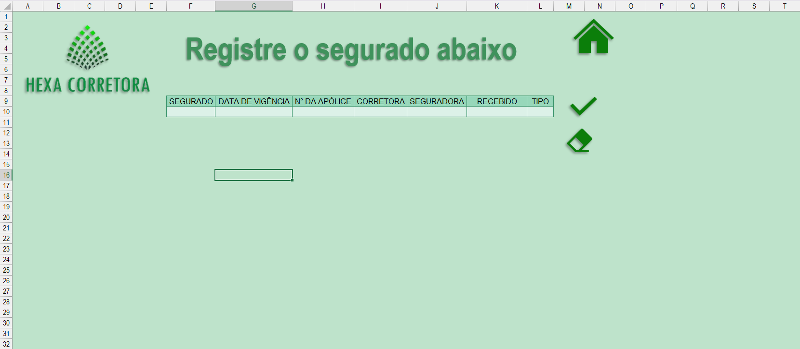
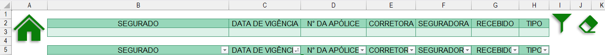
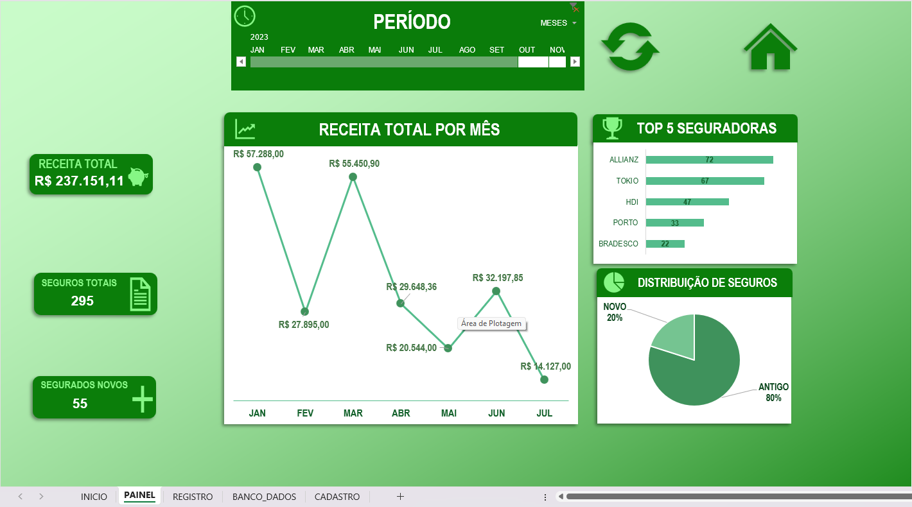

# 📊 Automação e Controle Financeiro | Corretora de Seguros

Projeto independente de Business Intelligence e automação de processos desenvolvido para estruturar a gestão financeira e operacional de uma corretora de seguros.

---

### 🎯 Problema de Negócio
O controle de comissões, renovações de apólices e cadastro de clientes era realizado de forma totalmente manual, baseado exclusivamente em arquivos físicos organizados por ordem de vigência dos seguros. Esse formato dificultava a consolidação do faturamento mensal e tornava a busca por dados específicos de um segurado lenta e sujeita a erros.

### 💡 A Solução
Desenvolvi um ecossistema digital centralizado em Excel para automatizar a entrada de dados e gerar visibilidade estratégica sobre a receita do negócio:

* **Levantamento de Requisitos e KPIs:** Mapeamento das métricas essenciais junto à gestão para estruturar os indicadores financeiros.
* **Processo de ETL:** Extração, limpeza, padronização e digitalização dos registros históricos de clientes e comissões.
* **Automação de Cadastro (VBA):** Criação de formulário de entrada integrado a macros em VBA para validar e consolidar novos registros automaticamente na base principal.
* **Análise e Dashboard Interativo:** Uso de Tabelas Dinâmicas e gráficos interativos com segmentação de dados para acompanhar a performance mensal e filtrar informações de segurados rapidamente.

### 🛠️ Ferramentas Utilizadas
* **Microsoft Excel Avançado** (Fórmulas, Tabelas Dinâmicas e Gráficos Dinâmicos)
* **VBA (Visual Basic for Applications)** para formulários e automação de rotinas

### 📈 Resultados Alcançados
* **Redução de aproximadamente 83%** no tempo de busca e recuperação das informações de clientes e apólices.
* **Visibilidade financeira consolidada**, substituindo controles manuais por indicadores claros de receita e renovações.
* **Maior integridade dos dados**, eliminando falhas de digitação e retrabalho na atualização da base.

---

### 🖼️ Visão Geral do Projeto

#### Menu Inicial e Navegação

#### Formulário de Cadastro Automatizado (VBA)

#### Base Estruturada e Filtros de Consulta

#### Dashboard e Indicadores Financeiros

---

> *Nota: Por questões de confidencialidade e privacidade (LGPD), todos os dados exibidos nas capturas de tela são fictícios.*
